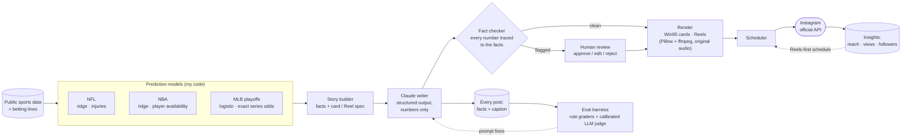

# BoxScoreBrief

**A sports-by-the-numbers Instagram account that runs itself, and an eval harness that keeps it honest.**

[@boxscorebrief](https://www.instagram.com/boxscorebrief/) posts NFL, NBA and MLB predictions every day.
My own models make the picks, Claude writes each caption from the numbers only, a fact checker blocks
invented stats, and the posts publish through Instagram's official API, all on a schedule, with no one at the keyboard.
Honesty is the brand: every miss gets posted, and the models are scored against the betting market in public.

## At a glance

| | |
|---|---|
| **Live since** | Oct 12, 2026 · 113 posts published automatically · 407 followers in 4 weeks |
| **What works on Instagram** | Reels reach ~10× more accounts than image posts (avg 94 vs. 9), so the schedule is Reels-first |
| **Caption quality** | 3.38 → **4.81** / 5 on held-out posts after eval-driven prompt fixes; "loser framing" 9/16 → **0/16** |
| **LLM judge you can trust** | Calibrated against my hand labels: Cohen's kappa 0.44 → **0.61**, factual agreement 29/30 |
| **Fact checker** | False alarms cut **67%** (15 → 5 of 30 labeled posts) |
| **Agent vs. prompt** | A self-revising agent matched the improved prompt's quality at **~40× the tokens**, so production uses the prompt |
| **Models vs. the market** | NFL 65.6% on 2,219 held-out games (market 66.2%); NBA 66.8% on 8,913 games. The market is still ahead, and the page says so |
| **Engineering** | Python · FastAPI · Docker Compose · APScheduler · Claude API · 300+ tests across 4 repos |

## How it works

1. **Predict.** Three models I built and backtested walk-forward: NFL and NBA ridge models with injury and
   player-availability features, and an MLB playoff model that computes exact series and bracket odds.
   Every feature is recorded before the game is played, and a test mutates future data to prove nothing leaks.
2. **Tell the story.** A source module turns each prediction into a `Story`: the exact facts a caption may use,
   plus the card or Reel to draw.
3. **Write.** Claude writes the headline, caption and hashtags from those facts only, returned as structured output.
4. **Check.** A fact checker traces every number in the caption back to the facts, allowing derived numbers
   ("a 66% favorite loses about 1 in 3") but not invented ones. Clean posts publish automatically; flagged posts
   wait for me on a review dashboard.
5. **Render and publish.** Win95-style images and 1080×1920 Reels are drawn in Python with original synthesized
   sound, then scheduled and published through Instagram's official API.
6. **Measure.** Insights flow back every 6 hours (Reels proved to have ~10× the reach, so the schedule changed),
   and the eval harness grades captions with rule checks and an LLM judge calibrated against my own labels.
